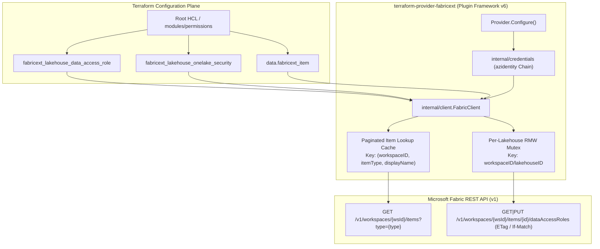
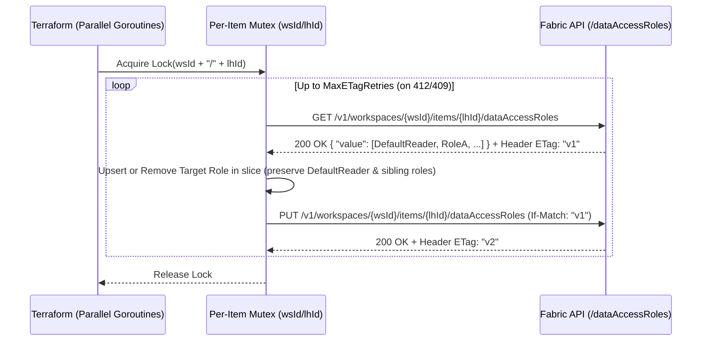
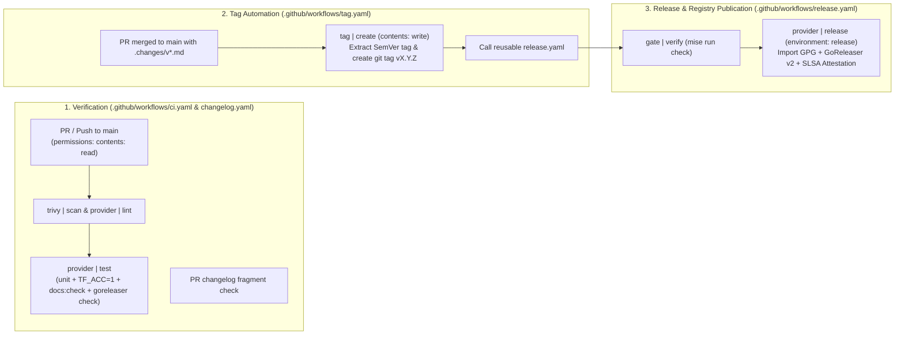
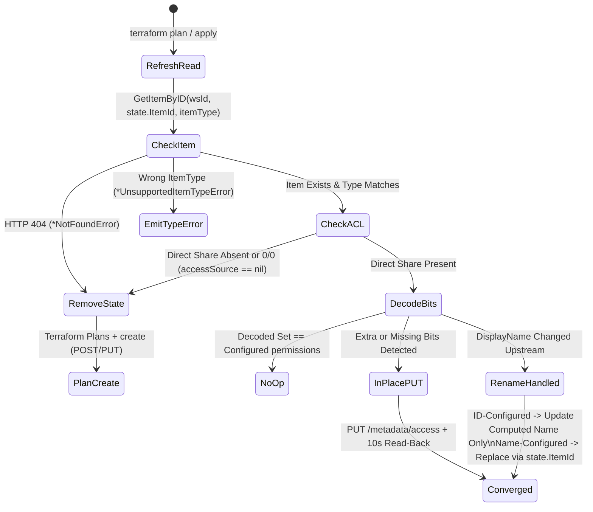

# Design & Architecture Specification: `terraform-provider-fabricext`

> **Provider Notice:** `terraform-provider-fabricext` (`registry.terraform.io/jambazid/fabricext`) is a purpose-built Terraform Plugin Framework (Protocol v6) provider for declaratively managing Microsoft Fabric Lakehouse OneLake Data Access Roles, security lifecycles, and advanced governance extensions (`fabricext_*`). For standard workspace and item provisioning, see Microsoft's official [`microsoft/fabric` Terraform provider](https://github.com/microsoft/terraform-provider-fabric).
>
> **Pre-Alpha Stability Notice:** This provider is currently in **pre-alpha** (`v0.x`) and is **not stable**. Resource schemas, API contracts, and state representations may change without backwards compatibility prior to `v1.0.0`. Consumers must pin provider versions (`~> 0.7.0`) in `required_providers`.

---

## 1. Executive Summary

### 1.1 Problem Statement

Microsoft's official [`microsoft/fabric` Terraform provider](https://registry.terraform.io/providers/microsoft/fabric/latest) supports provisioning Microsoft Fabric workspaces, capacities, workspace role assignments, and core items (`fabric_warehouse`, `fabric_lakehouse`, `fabric_sql_database`). However, it currently lacks declarative resources for **item-level sharing and granular data-access permissions**:

1. **Item-Level Sharing (`Warehouse`, `SQLDatabase`, `Lakehouse`)**: Item-level sharing endpoints do not exist in the public Fabric REST API; sharing is managed via the Fabric portal UI or undocumented Power BI metadata APIs (`/metadata/access`).
2. **OneLake Data Access Roles (`Lakehouse`)**: Managing OneLake Data Access Roles (`/dataAccessRoles`) that scope folder/table path permissions (`/Tables/...`, `/Files/...`) to specific Microsoft Entra ID security groups, users, or service principals.
3. **Cross-Plane Verification**: Verifying that permissions provisioned via item-level sharing are actively reflected across Fabric Admin REST API audit endpoints.

### 1.2 Architectural Solution

`terraform-provider-fabricext` addresses this with a native Go Terraform Plugin Framework (Protocol v6) provider (`fabricext`):

- **`fabricext_warehouse_permission`**: Declaratively manages direct item-level sharing permissions (`Read`, `ReadData`, `ReadAll`, `Reshare`) for Fabric Warehouses via Power BI metadata access endpoints with in-place drift reconciliation.
- **`fabricext_sql_database_permission`**: Declaratively manages direct item-level sharing permissions (`Read`, `Write`, `ReadData`, `ReadAll`, `Reshare`, `Execute`) for Fabric SQL Databases via Power BI metadata access endpoints with in-place drift reconciliation.
- **`fabricext_lakehouse_permission`**: Declaratively manages direct item-level sharing permissions (`Read`, `ReadData`, `ReadAll`, `Reshare`, `Execute`) for Fabric Lakehouses via Power BI metadata access endpoints with in-place drift reconciliation.
- **`fabricext_item_share_gate`**: Waiter resource verifying effective direct and inherited item permissions via the official Fabric Admin REST API (`GET /v1/admin/workspaces/{workspaceId}/items/{itemId}/users`).
- **`fabricext_lakehouse_data_access_role`**: Declarative lifecycle (`Create`, `Read`, `Update`, `Delete`, `ImportState`) for Lakehouse OneLake Data Access Roles using a per-item mutex and optimistic concurrency (`ETag` / `If-Match`) Read-Modify-Write (RMW) loop.
- **`fabricext_lakehouse_onelake_security`**: Declarative lifecycle (`Create`, `Read`, `Update`, `Delete`, `ImportState`) verifying OneLake security enablement, purging permissive `DefaultReader` roles, and observing state drift.
- **`fabricext_item` (Data Source)**: Singular item lookup resolving `(workspace_id, display_name, type)` to its canonical Fabric item `id`.
- **`data.fabricext_item_access_details` (Data Source)**: Inspects effective direct and inherited item permissions for a workspace item via the official Fabric Admin REST API.
- **`modules/permissions` (In-Repo HCL Submodule)**: Declarative matrix wrapper managing Lakehouse, Warehouse, and SQL Database item permissions and OneLake Data Access Roles across workspaces.

---

## 2. Requirements Traceability Matrix

| ID | Requirement Summary | Target Artifacts | Verification Gate |
| :--- | :--- | :--- | :--- |
| **REQ-001** | Refine `.docx` design into an authoritative, zero-gap specification resolving all API, concurrency, auth, and lifecycle defects | [`DESIGN.md`](DESIGN.md), `specs/**/*.spec.md` | `mise run spec:verify` |
| **REQ-002** | Implement custom Go Terraform provider (`fabricext`) with `fabricext_lakehouse_data_access_role`, `fabricext_lakehouse_onelake_security`, `fabricext_item`, `fabricext_warehouse_permission`, `fabricext_sql_database_permission`, `fabricext_lakehouse_permission`, and `fabricext_item_share_gate` | `main.go`, `internal/credentials/`, `internal/client/`, `internal/provider/` | `mise run test:unit`, `mise run test:acc` |
| **REQ-003** | Provide reusable HCL wrapper module (`modules/permissions/`) and zero-module native `for_each` examples | `modules/permissions/*.tf`, `examples/` | `mise run lint`, `mise run scan` |
| **REQ-004** | Consolidate all tooling and tasks into `mise.toml` (`minimum_release_age = "7d"`), retire `Taskfile.yaml`, and enforce `prek` hooks (`commitizen`, `rumdl`, `yamllint`, `zizmor`, `trivy`, `golangci-lint`) | `mise.toml`, `.pre-commit-config.yaml`, `trivy.yaml`, `.golangci.yaml`, `.rumdl.toml`, `.yamllint.yaml` | `mise run check`, `mise exec -- prek run --all-files` |
| **REQ-005** | Generate and validate Registry documentation via `tfplugindocs` with prominent Stopgap and Pre-Alpha banners | `templates/index.md.tmpl`, `docs/`, `README.md` | `mise run docs:check` |
| **REQ-006** | Vendor official `microsoft/fabric-rest-api-specs` OpenAPI definitions in `specs/fabric/` and native Power BI metadata contract in `specs/powerbi/metadata/`, enforcing runtime schema validation in mock tests via `kin-openapi` | `specs/fabric/`, `specs/powerbi/metadata/`, `internal/testutil/fabricmock/`, `internal/testutil/pbimock/` | `mise run specs:check`, `mise run test` |
| **REQ-007** | Implement StepSecurity-hardened GitHub Actions CI/CD (`jambazid/gha-actions` style) with automatic Conventional Commits release (`svu` + `goreleaser`) and 7-day Dependabot cooldown | `.github/workflows/ci.yaml`, `.github/dependabot.yaml`, `.goreleaser.yaml`, `terraform-registry-manifest.json` | `mise run scan`, `goreleaser check` |
| **REQ-008** | Document contributor extensibility, roadmap/deprecation policy, and security posture | [`CONTRIBUTING.md`](CONTRIBUTING.md), [`ROADMAP.md`](ROADMAP.md), [`SECURITY.md`](SECURITY.md) | `mise run lint` |
| **REQ-DOCS-008** | Purge nonexistent Fabric v1 REST sharing claims and fake overlays, documenting Power BI metadata access endpoints for item sharing | `templates/**`, `docs/**`, `guides/`, `examples/`, `modules/permissions/` | `go test -run TestRegistryDocs_NoActiveItemSharingClaims`, `mise run docs:check` |
| **REQ-DOCS-009** | Document honest technical comparison narrative against official provider, detailing OneLake zero-trust purging, ETag concurrency, and contract testing | `templates/guides/official_provider_comparison.md.tmpl`, `guides/official_provider_comparison.md` | `go test -run TestRegistryDocs_HonestComparisonNarrative`, `mise run docs:check` |
| **REQ-DOCS-010** | Reorganize access control guides under subcategory Guides, remove Use Cases title prefixes, apply open-ended connectivity phrasing, include Atlas, and purge legacy role names | `templates/guides/`, `docs/guides/`, `guides/` | `go test -run TestRegistryDocs_GuidesReorganizationAndPhrasing`, `mise run docs:check` |

---

## 3. System Architecture



---

## 4. Native Authentication Architecture

Rather than shelling out to external CLIs on every request, `internal/credentials` implements the exact credential resolution architecture of Microsoft's official Fabric provider using Microsoft's official Go Identity SDK: **`github.com/Azure/azure-sdk-for-go/sdk/azidentity`**, **`github.com/Azure/azure-sdk-for-go/sdk/azcore/policy`**, and **`software.sslmate.com/src/go-pkcs12`**.

### 4.1 Token Scopes

Microsoft Entra ID token audience scopes are dynamically resolved based on the configured `environment` (`"public"`, `"usgovernment"`, `"china"`):

| Cloud Environment | Azure SDK Cloud (`cloud.Configuration`) | Microsoft Fabric Token Scope |
| :--- | :--- | :--- |
| `public` (Default) | `cloud.AzurePublic` | `https://api.fabric.microsoft.com/.default` |
| `usgovernment` | `cloud.AzureGovernment` | `https://api.fabric.microsoft.us/.default` |
| `china` | `cloud.AzureChina` | `https://api.fabric.microsoft.cn/.default` |

### 4.2 Credential Evaluation Chain

`credentials.NewChain(cfg)` replaces all pre-existing authentication wiring with a unified, ordered evaluation chain matching `microsoft/terraform-provider-fabric`:

1. **`StaticTokenProvider` (`Source: "static_access_token"`)**:
   - Uses explicit `access_token` from provider configuration or `FABRIC_ACCESS_TOKEN`.
   - Primary mechanism for hermetic unit/acceptance testing (`TF_ACC=1` against `fabricmock`) and pre-minted CI tokens.
2. **`ClientCertificateProvider` (`Source: "service_principal_client_certificate"`)**:
   - Uses `software.sslmate.com/src/go-pkcs12` to parse base64-encoded PKCS#12 certificate bundles (`client_certificate`) or files (`client_certificate_file_path`) with optional password (`client_certificate_password`).
   - Instantiates `azidentity.NewClientCertificateCredential(tenantID, clientID, certs, key, &options)`.
3. **`ClientSecretProvider` (`Source: "service_principal_client_secret"`)**:
   - Uses `azidentity.NewClientSecretCredential(tenantID, clientID, clientSecret, &options)`.
   - Supports direct strings or file paths (`tenant_id_file_path`, `client_id_file_path`, `client_secret_file_path`).
   - **OIDC 3-Tuple Fallthrough Law**: In GitHub Actions OIDC (`azure/login`), `AZURE_TENANT_ID` and `AZURE_CLIENT_ID` are exported *without* `AZURE_CLIENT_SECRET`. If only 1 or 2 of the 3 values are set via environment variables, `ClientSecretProvider` records a skipped diagnostic and cleanly falls through to OIDC and CLI providers.
4. **`AzureDevOpsOIDCProvider` (`Source: "azure_devops_workload_identity_federation"`)**:
   - Uses `azidentity.NewAzurePipelinesCredential` when `azure_devops_service_connection_id` (or `FABRIC_AZURE_DEVOPS_SERVICE_CONNECTION_ID`) and OIDC request tokens (`SYSTEM_ACCESSTOKEN` / `oidc_request_token`) are supplied.
5. **`WorkloadIdentityProvider` (`Source: "workload_identity_oidc"`)**:
   - Supports direct `oidc_token`, `oidc_token_file_path`, or assertion callback via `azidentity.NewClientAssertionCredential`, and automatic Kubernetes/Actions federation via `azidentity.NewWorkloadIdentityCredential` when `AZURE_FEDERATED_TOKEN_FILE` is present.
6. **`ManagedIdentityProvider` (`Source: "managed_identity"`)**:
   - Uses `azidentity.NewManagedIdentityCredential` when `use_msi = true` or `FABRIC_USE_MSI` / `ARM_USE_MSI` is present.
   - Distinguishes **System-Assigned** (`clientID == ""`) from **User-Assigned** (`&azidentity.ManagedIdentityCredentialOptions{ID: azidentity.ClientID(clientID)}`).
7. **`AzureDeveloperCLIProvider` (`Source: "azure_developer_cli"`)**:
   - Uses `azidentity.NewAzureDeveloperCLICredential` when `use_dev_cli = true` or `FABRIC_USE_DEV_CLI=true`.
8. **`AzureCLIProvider` (`Source: "azure_cli"`)**:
   - Uses `azidentity.NewAzureCLICredential` (enabled by default via `use_cli = true` or `FABRIC_USE_CLI`).
   - **Zero Subprocess / Shell Execution**: Operates exclusively via the official Microsoft Azure SDK for Go (`github.com/Azure/azure-sdk-for-go/sdk/azidentity`). No raw `os/exec` subprocesses, shell invocations, or temporary token files are spawned anywhere in the codebase.

### 4.3 Multi-Tenant Acquisition (`auxiliary_tenant_ids`)

When `auxiliary_tenant_ids` (or `FABRIC_AUXILIARY_TENANT_IDS`) is specified, the chain propagates the slice to `AdditionallyAllowedTenants` across all underlying `azidentity` credential options, supporting multi-tenant Microsoft Fabric architectures.

### 4.4 Token Caching Invariants

- **Thread-Safe Caching & Proactive Refresh**: `Chain` caches the resolved `azcore.AccessToken` in memory (`sync.RWMutex`) and refreshes it automatically when `time.Until(token.ExpiresOn) < 2*time.Minute`.
- **Secret Redaction**: `Credentials` and `Config` implement `fmt.Stringer` and `fmt.GoStringer` masking raw bearer tokens, client secrets, certificate bytes, and passwords as `"[REDACTED]"`.
- **Exhausted Chain Diagnostics**: When all sources fail, `Chain.GetToken(ctx)` returns a `*ChainError` wrapping `ErrNoCredentials` listing every attempted source and its diagnostic failure reason.

---

## 5. Client and Concurrency

### 5.1 Paginated Lookup Cache

In Microsoft Fabric, creating a `Lakehouse` or `SQLDatabase` named `analytics_gold` automatically provisions a companion `SQLEndpoint` item also named `analytics_gold` in the same workspace.

- **Endpoint**: `GET /v1/workspaces/{workspaceId}/items?type={itemType}` (following `continuationToken` query parameters until `continuationToken` is empty).
- **Cache Key**: Strictly `(workspaceID, itemType, displayName)` where `itemType` is one of `"Warehouse"`, `"Lakehouse"`, or `"SQLDatabase"`.
- **Cache-Miss Refresh**: If an item is not found in a previously cached workspace page list, the cache entry for `(workspaceID, itemType)` is invalidated once and re-fetched from the API to handle items created during the same Terraform run.
- **Reverse Lookup on Import (`GetItemByID`)**: When a resource is imported via `terraform import` using its UUID composite ID, `Read` calls `GetItemByID(ctx, workspaceID, itemID, itemType)` to populate the required `warehouse_name`, `sql_database_name`, or `lakehouse_name` state attribute.

### 5.2 HTTP Resilience

- **Rate Limiting (`429 Too Many Requests`)**: Parses the `Retry-After` response header (seconds) and waits for the specified duration (or exponential backoff with jitter starting at `BaseBackoff` (`100ms` default) if `Retry-After` is absent), respecting `ctx.Done()`.
- **Transient Server Errors (`502`, `503`, `504`)**: Retries up to `MaxRetries` (default `5`) with exponential backoff (`BaseBackoff * 2^attempt`) plus bounded jitter, respecting `ctx.Done()`.

### 5.3 Item Permissions Concurrency & Lifecycle

Direct item-level sharing on Warehouses, SQL Databases, and Lakehouses is managed via Power BI metadata access endpoints (`/metadata/access` and `/metadata/access/notify`) discovered from the regional cluster cookie (`ClusterUri`). Because multiple resources or configurations may mutate permissions on the same item concurrently, mutations are synchronized using an in-memory per-item mutex (`getItemAccessLock(workspaceID, itemID)`).

After issuing an access grant (`POST /metadata/access/notify`) or revocation (`PUT /metadata/access`), the client executes a bounded read-back verification polling loop (up to 10s) against `GET /metadata/access/artifacts/{itemId}` to verify that effective stored bitmasks match the requested state. If permissions fail to converge or are dropped, a `*SilentPermissionDropError` is returned. Drift is detected during `Read`: if an item share is missing or revoked out of band, `resp.State.RemoveResource(ctx)` cleanly unlinks the state.

### 5.4 Lakehouse Roles Concurrency

Microsoft Fabric's OneLake Data Access Security endpoint (`GET` & `PUT /v1/workspaces/{workspaceId}/items/{itemId}/dataAccessRoles`) operates on the **entire array of roles** for a Lakehouse as a single document guarded by HTTP `ETag` / `If-Match`.



- **In-Process Mutex**: `FabricClient` maintains a `sync.Map` of per-Lakehouse mutexes keyed by `workspaceID + "/" + lakehouseID` so parallel Terraform resource workers (`-parallelism=10`) operating on the same Lakehouse serialize their Read-Modify-Write cycles deterministically within the process.
- **Cross-Process & Distributed Concurrency Across Independent Stacks/Pipelines**:
  - Microsoft Fabric provides **no distributed locking API** (no lease or advisory lock endpoints on workspaces or Lakehouses).
  - Cross-process and cross-pipeline synchronization relies strictly on HTTP `ETag` + `If-Match` optimistic concurrency.
  - Every `GET /dataAccessRoles` captures the response `ETag` header. The mutating request submits `PUT /dataAccessRoles` with `If-Match: <ETag>`.
  - **Paginated Collection Retrieval & Single-Document ETag Invariant**: `ListDataAccessRoles` follows `continuationToken` query parameters across all pages using the client's configured base URL, concatenating role slices until `continuationToken` is empty. The response-header `ETag` must remain identical across all pages; if the header `ETag` changes between pages, the client aborts the scan, treats it as a concurrency conflict, and retries the entire list sequence (counting against `MaxETagRetries`). The client never uses or transmits item-level `eTag` properties found inside individual `DataAccessRoleListItem` objects.
  - **ETag Normalisation**: The client normalizes `ETag` values before transmission. Strong entity tags are required by RFC 9110 §13.1.1 for `If-Match`. Weak tags (`W/"..."`), empty tags, or tags containing rogue quotes are rejected with an explicit error. Unquoted tags (e.g. `etag-v1`) are safely quoted as `"etag-v1"`, while already quoted tags are passed through.
  - **Architecture Decision Record: Bulk vs. Single-Role API (DEC-3)**:
    - `microsoft/fabric` (upstream) manages roles via preview-gated single-role operations (`POST /dataAccessRoles`, `DELETE /dataAccessRoles/{roleName}`).
    - `fabricext` uses the generally available bulk `/dataAccessRoles` endpoints with optimistic concurrency (per-item mutex, `If-Match` RMW, and full pagination resolution). This provides general availability without requiring users to enable preview mode at the provider level, while safely preserving unmanaged sibling roles.
  - **Write-Safety & Constraint Validation**:
    - Microsoft Fabric does not support combining `ReadWrite` actions with row-level security (`row_constraint`) or column-level security (`column_constraint`) within a decision rule.
    - `ValidateConfig` rejects configurations that combine `ReadWrite` with row or column constraints with a blocking error.
    - The `Write` action is deprecated in `v0.3.0` and emits a warning diagnostic in favor of `ReadWrite`. Role names are capped at 128 characters (`LengthAtMost(128)`).
  - If an independent Terraform stack or external process commits a modification between the `GET` and `PUT`, Fabric rejects the second mutation with HTTP `412 Precondition Failed` (or `409 Conflict`).
  - `FabricClient` automatically intercepts `412`/`409`, refetches the latest remote role array and updated `ETag`, reapplies the target role mutation in-memory, and retries with linear backoff plus jitter (up to 10 attempts / $\sim 5.5\text{s}$).
  - For cross-stack isolation where multiple stacks declare permissions on the same workspace, Terraform remote backend state locking (e.g. Terraform Cloud, Azure Blob Storage lease, or S3 DynamoDB lock) remains the standard IaC control preventing concurrent runs on shared stacks.
- **Preservation of Built-in & Sibling Roles**: `UpsertDataAccessRole` replaces only the role matching `role_name` (case-insensitive match, preserving canonical name) or appends it if new, leaving `DefaultReader` and all other roles untouched. `DeleteDataAccessRole` filters out only `role_name` (case-insensitive match).
- **Official Payload Structure** (verified against `microsoft/fabric-rest-api-specs/platform/definitions/platform.json` and `microsoft/fabric-sdk-go/fabric/core`):

  ```json
  {
    "value": [
      {
        "name": "GoldLayerReaders",
        "decisionRules": [
          {
            "effect": "Permit",
            "permission": [
              {
                "attributeName": "Path",
                "attributeValueIncludedIn": ["/Tables/gold_sales", "/Files/raw"]
              },
              {
                "attributeName": "Action",
                "attributeValueIncludedIn": ["Read"]
              }
            ]
          }
        ],
        "members": {
          "microsoftEntraMembers": [
            {
              "tenantId": "<workspace-or-configured-tenant-id>",
              "objectId": "11111111-1111-1111-1111-111111111111",
              "objectType": "Group"
            }
          ]
        }
      }
    ]
  }
  ```

### 5.5 Runtime OpenAPI Validation

- All vendored Swagger 2.0 specs under `specs/fabric/` (`platform/`, `warehouse/`, `lakehouse/`, `sqlDatabase/`, and `common/`) are verified by SHA-256 digest in `specs/fabric/lock.json` and loaded at test initialization by `github.com/getkin/kin-openapi` (`openapi2` $\rightarrow$ `openapi2conv.ToV3`). All contract files strictly originate from upstream `microsoft/fabric-rest-api-specs`.
- `fabricmock.Server` wraps its stateful HTTP router in an `openapi3filter` validation middleware that validates **every incoming HTTP request** (`openapi3filter.ValidateRequest`) and **every outgoing HTTP response** (`openapi3filter.ValidateResponse`) against the converted OpenAPI v3 schemas.
- `pbimock.Server` loads the native OpenAPI 3.0.3 contract in `specs/powerbi/metadata/openapi.json` and enforces runtime `openapi3filter` request/response schema validation across all Power BI metadata `/metadata/*` endpoints.

---

## 6. Schemas and Specifications

### 6.1 Provider Schema

| Attribute | Type | Required | Environment Variable Fallback | Description |
| :--- | :--- | :--- | :--- | :--- |
| `endpoint` | `String` | Optional | `FABRIC_ENDPOINT` | Base URL for the Microsoft Fabric REST API. Defaults to `"https://api.fabric.microsoft.com"`. |
| `access_token` | `String` (`Sensitive`) | Optional | `FABRIC_ACCESS_TOKEN` | Static Microsoft Entra ID bearer token for the Fabric API. |
| `tenant_id` | `String` | Optional | `AZURE_TENANT_ID`, `ARM_TENANT_ID`, `FABRIC_TENANT_ID` | Microsoft Entra ID tenant UUID. |
| `client_id` | `String` | Optional | `AZURE_CLIENT_ID`, `ARM_CLIENT_ID`, `FABRIC_CLIENT_ID` | Service Principal or Managed Identity client UUID. |
| `client_secret` | `String` (`Sensitive`) | Optional | `AZURE_CLIENT_SECRET`, `ARM_CLIENT_SECRET`, `FABRIC_CLIENT_SECRET` | Service Principal client secret. |
| `use_oidc` | `Bool` | Optional | `AZURE_USE_OIDC`, `ARM_USE_OIDC`, `FABRIC_USE_OIDC` | Enable Workload Identity (OIDC) federated token authentication. |
| `use_msi` | `Bool` | Optional | `AZURE_USE_MSI`, `ARM_USE_MSI`, `FABRIC_USE_MSI` | Enable Azure Managed Identity authentication. |
| `use_cli` | `Bool` | Optional | `AZURE_USE_CLI`, `ARM_USE_CLI`, `FABRIC_USE_CLI` | Enable Azure CLI credential fallback. |
| `request_timeout` | `String` | Optional | `FABRIC_REQUEST_TIMEOUT` | Per-request HTTP timeout (Go duration string, e.g. `"60s"`). Defaults to `"60s"`. |
| `skip_credentials_validation` | `Bool` | Optional | `FABRIC_SKIP_CREDENTIALS_VALIDATION` | Skip eager token acquisition during `Configure()`. Defaults to `false`. |

See the embedded Terraform Registry guide [`docs/guides/official_provider_comparison.md`](docs/guides/official_provider_comparison.md) (generated from [`templates/guides/official_provider_comparison.md.tmpl`](templates/guides/official_provider_comparison.md.tmpl) via `mise run docs`) for the full comparative analysis with Microsoft's official [`microsoft/terraform-provider-fabric`](https://github.com/microsoft/terraform-provider-fabric) and the Terraform 1.7+ state migration playbooks for Lakehouses, Warehouses, and SQL Databases.

### 6.2 `fabricext_warehouse_permission` Resource

- **Status**: Active (restored in `v0.7.0` via Power BI metadata access API).
- **Composite ID & Import Format**: `{workspace_id}/{warehouse_id_or_name}/{principal_type}/{principal_id}`
- **Permissions**: Set of strings (`Read`, `ReadData`, `ReadAll`, `Reshare`). Must include `Read`.
- **Plan Modifiers**: `warehouse_id` uses `RequiresReplaceIfConfigured()` so upstream renames do not force replacement when configured by name.

### 6.3 `fabricext_sql_database_permission` Resource

- **Status**: Active (restored in `v0.7.0` via Power BI metadata access API).
- **Composite ID & Import Format**: `{workspace_id}/{sql_database_id_or_name}/{principal_type}/{principal_id}`
- **Permissions**: Set of strings (`Read`, `Write`, `ReadData`, `ReadAll`, `Reshare`, `Execute`). Must include `Read`.
- **Plan Modifiers**: `sql_database_id` uses `RequiresReplaceIfConfigured()` so upstream renames do not force replacement when configured by name.

### 6.4 `fabricext_lakehouse_data_access_role` Resource

- **Composite ID & Import Format**: `{workspace_id}/{lakehouse_id}/{role_name}`
- **Dual-Mode Ergonomic Architecture**:
  - **Core Identifiers**:
    - `id` (`String`, `Computed`, `UseStateForUnknown`)
    - `workspace_id` (`String`, `Required`, `RequiresReplace`, UUID validator)
    - `lakehouse_name` (`String`, `Optional` + `Computed`, `RequiresReplace`, non-empty validator)
    - `lakehouse_id` (`String`, `Optional` + `Computed`, `RequiresReplace`, UUID validator; at least one of `lakehouse_name` or `lakehouse_id` must be provided)
    - `role_name` (`String`, `Required`, `RequiresReplace`, `^[a-zA-Z][a-zA-Z0-9_]*$` validator)
    - `kind` (`String`, `Optional` + `Computed`, default `"Policy"`, `OneOf("Policy")`)
  - **Simple Flat Mode (100% Backward Compatible)**:
    - `paths` (`Set[String]`, `Optional` + `Computed`, `SizeAtLeast(1)`)
    - `actions` (`Set[String]`, `Optional` + `Computed`, default `["Read"]`, `OneOf("Read", "Write", "ReadWrite")`)
    - `principal_ids` (`Set[String]`, `Optional` + `Computed`, `SizeAtLeast(1)`, UUID element validator)
    - `principal_type` (`String`, `Optional` + `Computed`, default `"Group"`, `OneOf("User", "Group", "ServicePrincipal", "ManagedIdentity")`)
  - **Advanced Structured Mode (Feature Parity with Upstream OneLake Data Access Security)**:
    - `decision_rule` (`List[Block]`, `Optional`): Repeatable decision rules containing:
      - `paths` (`Set[String]`, `Required`)
      - `actions` (`Set[String]`, `Optional` + `Computed`, default `["Read"]`, `OneOf("Read", "Write", "ReadWrite")`)
      - `effect` (`String`, `Optional` + `Computed`, default `"Permit"`, `OneOf("Permit")`)
      - `row_constraint` (`List[Block]`, `Optional`): Row-Level Security (RLS) predicates with `table_path` (`String`, `Required`) and `predicate` (`String`, `Required`, T-SQL expression).
      - `column_constraint` (`List[Block]`, `Optional`): Column-Level Security (CLS) masks with `table_path` (`String`, `Required`), `columns` (`Set[String]`, `Required`), `action` (`String`, `Optional`, default `"Read"`), and `effect` (`String`, `Optional`, default `"Permit"`).
    - `entra_member` (`Set[Block]`, `Optional`): Heterogeneous Entra ID members with `object_id` (`String`, `Required`), `object_type` (`String`, `Required`, `OneOf("User", "Group", "ServicePrincipal", "ManagedIdentity")`), and `tenant_id` (`String`, `Optional`). State refresh correlates existing state by `object_id`/`tenant_id` to preserve configured `object_type` when Fabric API omits `objectType` on GET.
    - `fabric_item_member` (`Set[Block]`, `Optional`): Cross-item shortcut members with `source_path` (`String`, `Required`, `{workspace_id}/{item_id}` UUID pair format) and `item_access` (`Set[String]`, `Optional`, default `["ReadAll"]`).
  - **Identifier Consistency & Replacement Law**: In `Create` on `lakehouse_data_access_role`, the provider determines configured identifiers directly from resource configuration (`req.Config`). If both the item name and item ID are explicitly configured, the provider validates that the fetched display name matches the configured name, returning a diagnostic error on conflict before setting state. On resource replacement where an item identifier changes, `ModifyPlan` resets the unconfigured counterpart identifier in the plan to unknown (`(known after apply)`), preventing stale computed identifiers copied by `UseStateForUnknown` from causing false replacement conflicts or inconsistent plan/apply results.

### 6.5 `fabricext_lakehouse_onelake_security` Resource

- **Composite ID & Import Format**: `{workspace_id}/{lakehouse_id}`
- **Attributes**:
  - `id` (`String`, `Computed`, `UseStateForUnknown`): Composite key `{workspace_id}/{lakehouse_id}`.
  - `workspace_id` (`String`, `Required`, `RequiresReplace`, UUID validator): Target Fabric workspace UUID.
  - `lakehouse_id` (`String`, `Optional` + `Computed`, `RequiresReplace`, UUID validator; at least one of `lakehouse_name` or `lakehouse_id` must be provided).
  - `lakehouse_name` (`String`, `Optional` + `Computed`, `RequiresReplace`, 1-256 chars; at least one of `lakehouse_name` or `lakehouse_id` must be provided).
  - `remove_default_reader_role` (`Bool`, `Optional` + `Computed`, default `true`): Whether to purge the built-in `DefaultReader` role during create/apply. `ModifyPlan` blocks reverting from `true` to `false` because Fabric provides no API to restore deleted `DefaultReader` roles.
  - `default_reader_role_exists` (`Bool`, `Computed`): Reflects remote presence of `DefaultReader` in Fabric for drift observability.
  - `enabled` (`Bool`, `Computed`): Reflects verified OneLake security enablement status.
- **Lifecycle Invariants**:
  - `Create`: Resolves identifiers, verifies enablement via `GET /dataAccessRoles`. If enabled and `remove_default_reader_role = true`, purges `DefaultReader` via `DeleteDataAccessRole`. If unenabled, fails loud with actionable portal instructions.
  - `Read`: Refreshes roles and updates `default_reader_role_exists`. If item is missing or security is unenabled (`OneLakeSecurityNotEnabledError`), calls `resp.State.RemoveResource(ctx)` so Terraform plans recreation on drift.
  - `Update`: If `remove_default_reader_role = true` and `DefaultReader` exists remotely (out-of-band drift), purges it.
  - `Delete`: Emits an informational warning diagnostic stating Fabric does not support disabling security; state is removed cleanly by Terraform core.
  - `ImportState`: Imports `{workspace_id}/{lakehouse_id}`, verifies enablement, and initializes `remove_default_reader_role` based on remote presence.

### 6.6 `fabricext_item` Data Source

- **Attributes**:
  - `workspace_id` (`String`, `Required`, UUID validator)
  - `display_name` (`String`, `Required`, non-empty validator)
  - `type` (`String`, `Required`, `OneOf("Warehouse", "Lakehouse", "SQLDatabase", "SQLEndpoint", "SemanticModel")`)
  - `id` (`String`, `Computed`): Resolved Fabric item UUID.

### 6.7 ADR: Atomic Resources

- **Context**: A single workspace-wide resource (`fabricext_workspace_permissions_model`) accepting a nested map of all item permissions across a workspace was evaluated as an alternative to atomic per-item resources (`fabricext_*`) + HCL composition.
- **Decision**: Reject the workspace-wide monolithic resource in favor of atomic resources (`fabricext_warehouse_permission`, `fabricext_sql_database_permission`, `fabricext_lakehouse_permission`, `fabricext_lakehouse_data_access_role`, `fabricext_lakehouse_onelake_security`) paired with native HCL `for_each` and the in-repo `modules/permissions/` submodule.
- **Evolution Context**: In `v0.5.0`, warehouse and SQL database permissions were temporarily removed pending discovery of the underlying item-sharing wire protocol. In `v0.7.0`, item-level sharing across Warehouses, SQL Databases, and Lakehouses was restored using the Power BI metadata access service with full OpenAPI schema contracts, read-back verification, and cross-plane Admin API verification gates.
- **Rationale (HashiCorp Provider Design Principles)**:
  1. **One Resource, One API**: A workspace-wide resource conflates distinct APIs.
  2. **Failure Isolation**: Each OneLake role binding is tracked independently in `terraform.tfstate`.
  3. **Drift & Import**: `resp.State.RemoveResource(ctx)` and `terraform import` operate on individual role instances cleanly.

---

## 7. Declarative Composition Architecture

### 7.1 Zero-Module Native Pattern

Practitioners can map a declarative matrix of OneLake Data Access Roles directly onto `fabricext_lakehouse_data_access_role` without consuming external modules:

```hcl
locals {
  workspace_id = "00000000-0000-0000-0000-000000000001"
  lakehouse_roles = {
    "raw_lh:analysts" = {
      lakehouse_name = "raw_bronze_lh"
      role_name      = "BronzeReaders"
      paths          = ["/Tables/customers", "/Files/landing"]
      actions        = ["Read"]
      principal_ids  = ["11111111-1111-1111-1111-111111111111"]
      principal_type = "Group"
    }
  }
}

resource "fabricext_lakehouse_data_access_role" "this" {
  for_each       = local.lakehouse_roles
  workspace_id   = local.workspace_id
  lakehouse_name = each.value.lakehouse_name
  role_name      = each.value.role_name
  paths          = each.value.paths
  actions        = each.value.actions
  principal_ids  = each.value.principal_ids
  principal_type = each.value.principal_type
}
```

### 7.2 In-Repo Permissions Module

`modules/permissions/` accepts a unified `fabric_permissions_matrix` variable, flattens Lakehouse role definitions keyed by `"${lakehouse_name}/${role_name}"`, and provisions `fabricext_lakehouse_data_access_role` and `fabricext_lakehouse_onelake_security` resources deterministically.

Key module capabilities:

1. Support direct item UUIDs as map keys (in addition to item display names) across `lakehouses`.
2. Support advanced Lakehouse OneLake Data Access Roles: repeatable `decision_rules` with Row-Level Security (`row_constraints`), Column-Level Security (`column_constraints`), heterogeneous `entra_members`, and `fabric_item_members` alongside the standard simple flat role configuration.
3. Enforce strict dependency ordering across the security enablement boundary: `fabricext_lakehouse_data_access_role.this` declares an explicit `depends_on = [fabricext_lakehouse_onelake_security.this]` so that OneLake security verification and `DefaultReader` purging complete before role mutations across all Lakehouses.
4. Inputs `warehouses` and `sql_databases` actively declare `fabricext_warehouse_permission` and `fabricext_sql_database_permission` resources, unifying item sharing and OneLake Data Access Roles across all supported engines under a single module.

---

## 8. Distribution and Release

Following [`hashicorp/terraform-provider-scaffolding-framework`](https://github.com/hashicorp/terraform-provider-scaffolding-framework), Changie release management, and StepSecurity privilege-isolation standards, continuous verification, tagging, and release publication are separated into dedicated workflows:



1. **Separated Verification vs. Release Workflows (`ci.yaml`, `tag.yaml`, & `release.yaml`)**:
   - **`ci.yaml`**: Runs on `pull_request` and `push` to `main` with read-only `contents: read` permissions and zero access to `GPG_PRIVATE_KEY` or the `release` GitHub Environment. Excludes non-code docs while guaranteeing test runs on `specs/**` and `DESIGN.md`. Renders statement coverage breakdowns to `$GITHUB_STEP_SUMMARY`, uploads coverage artifacts, updates PR sticky comments across both passing and failing runs, and validates the 90.0% coverage threshold via a dedicated verification step to ensure consistent error communication between step summaries and PR discussions.
   - **`changelog.yaml`**: Verifies that pull requests include required Changie fragments (`.changes/unreleased/*.yaml`) before merging.
   - **`tag.yaml`**: Triggered on `push` to `main` when `.changes/v*.md` files are added or modified. Extracts the version, validates strict SemVer format (`^v[0-9]+\.[0-9]+\.[0-9]+(-[0-9A-Za-z.-]+)?(\+[0-9A-Za-z.-]+)?$`), creates the git tag `vX.Y.Z` using `GITHUB_TOKEN`, and invokes `release.yaml` at the running commit via `uses: ./.github/workflows/release.yaml`.
   - **`release.yaml`**: Reusable workflow (`workflow_call` or manual `workflow_dispatch`):
     - **Stage 1 (`gate | verify`)**: Executes full verification gate (`mise run check`) before touching release secrets.
     - **Stage 2 (`provider | release`)**: Runs inside the protected `release` GitHub Environment (`contents: write`, `id-token: write`, `attestations: write`). Imports the GPG signing key via `step-security/ghaction-import-gpg`, runs `goreleaser release --clean` (pinned to match `mise.lock`), and emits SLSA Build Level 2 provenance attestations via `actions/attest-build-provenance`.
2. **Public & Private Registry Packaging (`.goreleaser.yaml` & `terraform-registry-manifest.json`)**:
   - Builds static (`CGO_ENABLED=0`) reproducible binaries (`mod_timestamp: '{{ .CommitTimestamp }}'`, `-trimpath`, `-ldflags='-s -w -X main.version={{.Version}} -X main.commit={{.Commit}}'`) named `terraform-provider-fabricext_v{{ .Version }}` across `linux`/`darwin`/`windows`/`freebsd` and `amd64`/`arm64`/`386`/`arm`.
   - Generates `${ProjectName}_${Version}_SHA256SUMS`, signs it with GPG (`--batch --local-user {{ .Env.GPG_FINGERPRINT }} --detach-sign`), and attaches `terraform-registry-manifest.json` (`protocol_versions: ["6.0"]`).
3. **Air-Gapped / Local Filesystem Mirror (`mise run install-local`)**:
   - Installs the compiled binary into `~/.terraform.d/plugins/registry.terraform.io/jambazid/fabricext/<version>/${GOOS}_${GOARCH}/terraform-provider-fabricext_v<version>` for offline runners or local testing.
4. **Semantic Pull Request Title Validation (`.github/workflows/semantic-pr.yaml`)**:
   - Validates pull request titles against Conventional Commits specifications.
   - Evaluates on `opened`, `synchronize`, `reopened`, and title-specific edits (`if: github.event_name != 'pull_request' || github.event.action != 'edited' || github.event.changes.title != null`), preventing redundant workflow runs when only the PR body is modified (e.g. updating task checklists).

---

## 9. Security Hardening Controls

1. **StepSecurity Harden-Runner & Pinned Actions**:
   - Every job in `.github/workflows/ci.yaml` and `.github/workflows/release.yaml` begins with `step-security/harden-runner` (`egress-policy: audit`).
   - All actions (`actions/checkout`, `actions/attest-build-provenance`, `step-security/harden-runner`, `step-security/mise-action`, `step-security/ghaction-import-gpg`) are pinned to full 40-character commit SHAs with `# vX.Y.Z` comments.
2. **7-Day Supply-Chain Cooldown & Grouped Dependabot Updates (`TeamPCP` Mitigation)**:
   - `mise.toml` enforces `lockfile = true` and `minimum_release_age = "7d"`.
   - `.github/dependabot.yaml` enforces `cooldown: { default-days: 7 }` on `github-actions` and `gomod`, with grouped updates for `github.com/hashicorp/terraform-plugin-*` and GitHub Actions (following `hashicorp/terraform-provider-scaffolding-framework`).
   - `mise run bump` executes `actions-up --min-age 7`.
3. **Zero `pull_request_target`, Zero Script Injection & `depguard` SDK Enforcement**:
   - Workflows trigger only on safe `pull_request`, `push`, and `workflow_dispatch` events with `permissions: {}` at top level and `persist-credentials: false` on every `actions/checkout`.
   - Dynamic expressions are never interpolated directly in `run:` scripts; all values pass through `env:`.
   - `.golangci.yaml` enforces `depguard` rules banning `github.com/hashicorp/terraform-plugin-sdk/v2` imports alongside `usetesting`, `govet`, `staticcheck`, `errcheck`, `gosec`, and `revive`.
4. **Continuous Vulnerability, Secret & Misconfiguration Scanning**:
   - `trivy fs` (vulnerabilities, secrets, misconfigurations) and `trivy config` (Terraform HCL scanning) + `zizmor` (GitHub Actions static analysis) run with identical configurations both locally in `prek` hooks and in CI (`trivy | scan` and `provider | lint`).

---

## 10. Registry Documentation Architecture

1. **Pre-Stable Experimental Positioning**:
   - The provider is explicitly documented as pre-`v1.0.0` experimental software published to validate automated packaging, supply-chain provenance, and early Fabric permission architectures.
   - All Registry landing pages and resource documents link to the official [`microsoft/fabric`](https://registry.terraform.io/providers/microsoft/fabric/latest) provider for core workspace infrastructure.
2. **Access Control Playbook**:
   - `templates/guides/access_control_playbook.md.tmpl` serves as the primary practitioner guide for least-privilege Fabric access.
   - Provides a comprehensive "Start Here" routing table across personas, items, and tooling.
   - Structured scenario cards include concrete `sqlcmd` and notebook verification commands and explicit least-privilege rationales.
3. **Primary-Source Citation Binding**:
   - All factual assertions regarding Fabric access controls, SQL endpoint modes, TDS connectivity, and OneLake role semantics bind to verifiable Microsoft Learn documentation cataloged in `specs/citations.md`.

---

## 11. Official Provider Comparison Architecture

### 11.1 Comparative Architectural Assessment

`terraform-provider-fabricext` is an advanced security companion provider rather than a competitor to the official [`microsoft/fabric`](https://registry.terraform.io/providers/microsoft/fabric/latest) provider:

1. **Breadth vs Specialization**: `microsoft/fabric` manages core platform resources (workspaces, capacities, items, and workspace roles). `fabricext` focuses specifically on Lakehouse OneLake Data Access Roles and security lifecycles.
2. **Item Sharing Parity**: The official provider does not manage Warehouse or SQL Database item sharing via REST because Microsoft Fabric does not offer public Fabric v1 REST endpoints for them. `fabricext` bridges this capability by declaratively managing item sharing across Warehouses, SQL Databases, and Lakehouses via internal Power BI metadata access endpoints with in-place drift reconciliation.
3. **Automated Zero-Trust Lifecycle**: `fabricext_lakehouse_onelake_security` automates verification and zero-trust deletion of the auto-generated `DefaultReader` role, preventing open read access from defeating custom RLS/CLS rules.
4. **ETag Concurrency Control**: `fabricext` provides per-Lakehouse in-memory mutex locking and RFC 9110 compliant `If-Match` ETag Read-Modify-Write retry on HTTP 412, preventing race conditions under parallel Terraform operations.
5. **Multi-Page Pagination Safety**: Follows `continuationToken` up to 100 pages with cycle detection and cross-page ETag consistency checks.
6. **Sub-10s Hermetic Offline Testing**: Acceptance tests run in seconds without live Azure cloud credentials against `fabricmock`, contract-validated via `kin-openapi` (`openapi3filter`).

---

## 12. Extension Surface Gap Roadmap

### 12.1 Fabric API Surface Analysis

Cross-referencing all 57 item and service domains in [`microsoft/fabric-rest-api-specs`](https://github.com/microsoft/fabric-rest-api-specs) against the 66 resources in `microsoft/terraform-provider-fabric` (v1.14.0) identifies 13+ unmanaged or partially managed API surfaces.

### 12.2 Candidate Extension Resource Priority

1. **User Data Functions (`fabricext_user_data_function`)**: High priority. Serverless Python functions with connected Lakehouse/Warehouse data sources, PyPI packages, and private `.whl` libraries (`userDataFunction/swagger.json`).
2. **Data Build Tool Jobs (`fabricext_data_build_tool_job`)**: High priority. Native Fabric execution of dbt projects (`dataBuildToolJob/swagger.json`).
3. **Mirrored Warehouses (`fabricext_mirrored_warehouse`)**: Medium priority. Declarative item provisioning for mirrored external warehouses.
4. **Graph Models & Query Sets (`fabricext_graph_model`)**: Medium priority. Fabric Knowledge Graph entity and schema definitions.

---

## 13. Item Share Verification Gate

### 13.1 Administrative Surface & Problem

While public Fabric v1 REST APIs do not offer write endpoints for item sharing, `fabricext` manages item permissions via internal Power BI metadata endpoints (`fabricext_*_permission`). To additionally verify cross-plane propagation across administrative boundaries or validate out-of-band portal grants before executing downstream operations (such as SQL schema migrations via Atlas, Flyway, or Liquibase, or data pipeline runs), the provider exposes a read-only projection data source and a verification waiter resource backed by the official Fabric Admin API (`GET /v1/admin/workspaces/{workspaceId}/items/{itemId}/users`, C54).

### 13.2 Security & Rate Limiting

1. **Administrative Scope**: The Admin API requires Fabric Administrator privileges or a Service Principal enrolled in the tenant setting *"Service principals can access read-only admin APIs"* with delegated scope `Tenant.Read.All` or `Tenant.ReadWrite.All` (C55). Standard workspace-level service principals receive HTTP 403 Forbidden. The provider detects 403 responses and emits an explicit diagnostic citing the required tenant setting.
2. **Quota Preservation**: Fabric limits admin metadata calls to 200 requests/hour per tenant (C56). To avoid exhausting this quota across concurrent resources:
   - Polling uses an initial 60-second backoff doubling up to a 300-second cap with randomized jitter.
   - The HTTP client honors `Retry-After` response headers on HTTP 429.
   - Pacing controls serialize admin requests across concurrent goroutines.
3. **Union Permission Evaluation**: Microsoft Fabric distinguishes standard item permissions (`permissions`: `Read`, `Write`, `Reshare`, `Explore`, `Execute`) from workload permissions (`additionalPermissions`: `ReadData`, `ReadAll`, C57). Matching evaluates against the union of both fields.

### 13.3 Data Source Architecture

`data.fabricext_item_access_details` reads and projects effective permissions on a given workspace item:

- `workspace_id` (String, Required, UUID)
- `item_id` (String, Required, UUID)
- `type` (String, Optional)
- `access_details` (List of Objects): Raw projection of all principals and their permission arrays.
- `principal_permissions` (Map of Set of Strings): Convenience lookup keyed by raw `principal_id` (UUID), mapping to the union of all granted permissions and additional permissions.

### 13.4 Waiter Resource Lifecycle

`resource.fabricext_item_share_gate` provides declarative gating without granting or revoking remote permissions:

1. **Create**: Polls the Admin API with exponential backoff until the named principal holds the expected permissions (subset match by default, or exact match). If the timeout expires without satisfaction, fails with an actionable diagnostic instructing the operator to verify or complete the item share.
2. **Read**: Re-evaluates effective permissions. If the target item returns HTTP 404, or the principal is missing, or permissions no longer satisfy the match condition, calls `resp.State.RemoveResource(ctx)` and returns cleanly without error diagnostics. This ensures `terraform destroy` executes cleanly as a zero-op, while `terraform plan` detects drift and plans recreation.
3. **Update**: In-place updates are permitted only for `expected_permissions` and `match_type`, triggering a re-poll. Changes to `workspace_id`, `item_id`, `principal_id`, `principal_type`, or `type` require resource replacement.
4. **Delete**: Pure local state removal with zero network requests.

---

## 14. Drift Detection & Convergence

### 14.1 Drift Scenario Matrix

Every `Read` and `Delete` lifecycle operation addresses Fabric items strictly by immutable `state.ItemID` (never re-looking up by mutable `state.ItemName`), ensuring deterministic drift recovery across all eight real-world drift classes:

| # | Out-of-Band Drift Scenario | Upstream Signal Observed in `Read` | State Action in `Read` | Graceful Terraform Convergence |
| :--- | :--- | :--- | :--- | :--- |
| **1** | **Direct share revoked in portal** (admin clicks *Remove access*; principal absent or `0/0` in `accessSource == nil`, even if principal retains a workspace role `accessSource != nil`) | `GetItemPermission` returns `*NotFoundError` | `resp.State.RemoveResource(ctx)` with zero error (`AGENTS.md` Law #5) | Terraform plans `+ create` and restores the exact configured `permissions` set via `UpsertItemPermission`. |
| **2** | **Privilege creep in portal** (someone ticks extra checkboxes such as *ReadAll* or *Reshare* in the Fabric Share dialog) | `DecodePermissions` returns superset (e.g., `["Read", "ReadData", "ReadAll"]` vs HCL `["Read", "ReadData"]`) | Writes actual superset into `resp.State` | Terraform plans **in-place `~ update`** (`- "ReadAll"`) and executes **`PUT /metadata/access`** (exact overwrite, not `POST` OR-merge) to strip unauthorized extra bits without resource replacement. |
| **3** | **Permission downgraded in portal** (someone unchecks *ReadData* or *Reshare*, leaving only `Read`) | `DecodePermissions` returns subset (`["Read"]`) | Writes actual subset into `resp.State` | Terraform plans **in-place `~ update`** (`+ "ReadData"`) and executes `PUT /metadata/access` + 10s read-back check to restore missing bits. |
| **4** | **Pre-existing unmanaged portal share before `Create`** (share already exists in Fabric before Terraform adopts it) | Pre-flight `GET` inside `UpsertItemPermission` finds existing `accessSource == nil` row | `UpsertItemPermission` switches from `POST` to `PUT /metadata/access` with exact target bitmask | Converges existing share cleanly to exact HCL `permissions` without duplicate errors or leftover portal bits. |
| **5** | **Unmanaged internal portal flag set** (e.g., `SubscribeOneLakeEvents = 32` added by portal telemetry alongside managed bits) | `storedArtifact` has bit `32` set | `DecodePermissions` projects strictly onto the workload's managed permission vocabulary | Zero phantom/perpetual diffs during `terraform plan`; `PUT` normalizes canonical bits on any subsequent `Update`. |
| **6** | **Target item deleted in portal** (Warehouse, Lakehouse, or SQL Database deleted outside Terraform) | `GetItemByID(wsID, state.ItemID, itemType)` returns HTTP `404` (`*NotFoundError`) | `Read` calls `resp.State.RemoveResource(ctx)` cleanly; `Delete` treats `404` as idempotent success | `terraform apply` plans clean recreation once the item exists; `terraform destroy` never blocks on an already-deleted item. |
| **7** | **Target item renamed in portal** (`sales_wh` renamed to `sales_wh_v2`) | `GetItemByID(wsID, state.ItemID, itemType)` returns `DisplayName = "sales_wh_v2"` | Updates `state.ItemName = "sales_wh_v2"`; invalidates `FabricClient` `(wsID, itemType)` name cache | • **Configured via `<item>_id` only**: `<item>_name` uses `stringplanmodifier.RequiresReplaceIfConfigured()`, so unconfigured computed name drift updates state seamlessly with **zero replacement**.<br>• **Configured via `<item>_name`**: Terraform plans replacement; `Delete` revokes on old `state.ItemID` cleanly and `Create` resolves `"sales_wh"` fresh from Fabric. |
| **8** | **Wrong item type UUID configured/imported** (e.g., companion `SQLEndpoint` UUID passed to `fabricext_lakehouse_permission`) | `GetItemByID` returns `*UnsupportedItemTypeError` (not `*NotFoundError`) | Preserves state and emits `"Item Type Mismatch"` error diagnostic | Prevents infinite `RemoveResource` $\rightarrow$ plan-recreate loops and surfaces the exact expected vs actual item type. |

### 14.2 Lifecycle State Flow



### 14.3 Immutable Addressing Invariant

1. **State Addressing**: In `Read` and `Delete`, the provider invokes `GetItemByID(wsID, state.ItemID, itemType)`. It never invokes lookup by display name during refresh.
2. **Replacement Control**: `<item>_name` and `<item>_id` use `stringplanmodifier.RequiresReplaceIfConfigured()`. When a practitioner configures `<item>_id = "..."` without configuring `<item>_name`, upstream renaming updates the computed `<item>_name` in state with zero planned changes or resource replacements.
3. **In-Place Overwrite**: When permissions drift out-of-band, Terraform issues an in-place `Update` (`ModifyPlan` does not force replacement for `permissions`). `UpsertItemPermission` issues `PUT /metadata/access`, overwriting the permission bitmask to match HCL exactly, followed by a 10-second read-back check.

---

## 15. Declarative Item Permissions

### 15.1 Wire Protocol & Bitmasks

Item-level permissions across Fabric Warehouses, Lakehouses, and SQL Databases are managed via undocumented Power BI `/metadata/access` endpoints using bijective bitmask encoding:

1. **Core Permissions Bitmask**: `None = 0`, `Read = 1`, `Write = 2`, `ReShare = 4`, `Explore = 8`, `CopyOnWrite = 16`, `WriteCheckRelaxForReadOnlyGroup = 32`, `Execute = 64`, `Subscribe = 128`.
2. **Workload Artifact Permissions Bitmask**:
   - `Read = 1`, `ReadData = 2`, `ReadAll = 4`, `Reshare = 8`, `Monitor = 16`, `SubscribeOneLakeEvents = 32`, `Audit = 64`, `Restore = 128`.
   - Resolved dynamically via `GET {cluster}/metadata/artifacts/definitions` with cached fallback.
3. **Bijective Mapping**:
   - `fabricext_warehouse_permission`: `Datawarehouse` definitions (`Read`, `ReadData`, `ReadAll`, `Reshare`, `Audit`, `Monitor`, `Restore`).
   - `fabricext_lakehouse_permission`: `Lakehouse` definitions (`Read`, `ReadData`, `ReadAll`, `Execute`, `Reshare`).
   - `fabricext_sql_database_permission`: `SQLDbNative` definitions (`Read`, `Write`, `Execute`, `Reshare`, `ReadData`, `ReadAll`).

### 15.2 Cluster Discovery & SSRF

1. **Bootstrap Discovery**: Cloned HTTP client with `CheckRedirect: http.ErrUseLastResponse` requests `GET https://app.powerbi.com/` (or sovereign cloud equivalent) with Power BI bearer token, following up to 5 manual hops and parsing raw `Set-Cookie: ClusterUri=...` headers.
2. **AST URL Allowlist**: Validates cluster URI using `url.Parse`, requiring HTTPS, empty query/fragment/path, and verified domain suffix (`.analysis.windows.net`, `.analysis.usgovcloudapi.net`, `.analysis.chinacloudapi.cn`) or configured `powerbi_endpoint`.

### 15.3 Principal XOR Rule

Every mutation payload to `/metadata/access` sets either internal Power BI IDs (`userId`/`groupId` on existing shares) XOR Entra Object IDs (`userObjectId` for Users and Service Principals/Managed Identities, XOR `groupObjectId` for Groups), never both.

### 15.4 Unified Module Architecture

`modules/permissions` unifies all item-level permissions and Lakehouse OneLake roles under a single matrix schema:

- Single `$.lakehouses` key composing both `permissions` (item shares) and `data_access_roles` (OneLake security).
- Principal-UUID-keyed maps (`map(object(...))`) across `warehouses`, `sql_databases`, and `lakehouses` guaranteeing duplicate immunity.
- Smart gating on `fabricext_lakehouse_onelake_security` via `optional(bool)` defaulting to `null`.

### 15.5 Share Gate Sanity Lever

Every `fabricext_*_permission` inside `modules/permissions` chains directly to a post-grant `fabricext_item_share_gate` Admin API verification resource:

- `verify_item_shares = optional(bool, true)` at matrix root and per-item.
- Chained with explicit `depends_on = [fabricext_*_permission.this]`.
- Downstream OneLake roles and module outputs depend on the gate, throwing a hard apply failure if cross-plane effective ACL verification fails.

### 15.6 Notification Routing & Messages

Item permissions support optional recipient notification and custom message delivery:

1. **Routing Mechanics**:
   - When `notify = true`: Dispatches `POST {cluster}/metadata/access/notify` using `notifyAccessRequestBody` with `emailNotificationMessage`. If `message` is empty or unset, Power BI delivers its standard template.
   - When `notify = false` (default): Grants execute silently via `POST /metadata/access` (new grant) or `PUT /metadata/access` (update) with `accessRequestBody`.
2. **Schema Validation Invariant**: `message` strictly requires `notify = true`. Configuring `message` without enabling `notify` fails configuration validation with an actionable diagnostic.
3. **Module Composition**: `modules/permissions` exposes top-level inputs `variable "notify"` and `variable "message"` providing module-level defaults, with optional per-principal overrides in the permission matrix (`coalesce(p.notify, var.notify)` and `coalesce(p.message, var.message)`).
