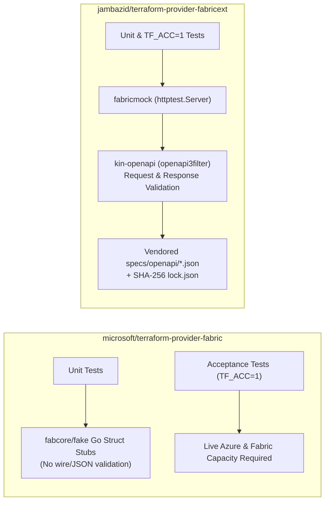

# Official Fabric Provider Comparison

Comparative architecture analysis between Microsoft's official Terraform provider ([`microsoft/terraform-provider-fabric`](https://github.com/microsoft/terraform-provider-fabric), `registry.terraform.io/microsoft/fabric`) and this community extension provider (`registry.terraform.io/jambazid/fabricext`).

---

## Executive Summary

| Dimension | `microsoft/fabric` (Official) | `jambazid/fabricext` (Community) |
| :--- | :--- | :--- |
| **Scope** | Workspace and item lifecycle provisioning | Specialized Lakehouse OneLake Data Access Roles |
| **API Layer** | Generated `fabric-sdk-go` client | Targeted REST client on official `platform/v1` APIs |
| **OneLake Roles** | Preview endpoints (`preview = true`); single-role calls | GA bulk endpoints, mutex + ETag Read-Modify-Write (RMW), automated `DefaultReader` purge |
| **Testing** | In-memory SDK fake clients; live cloud required for acceptance | Hermetic `fabricmock` + runtime `kin-openapi` contract validation |

### Architectural Trade-Off Analysis

| Dimension | Cost | Impact | Risk |
| :--- | :--- | :--- | :--- |
| **OneLake Specialization** | Low | High: Automated zero-trust `DefaultReader` purging | Low: Distinct `fabricext_*` prefix |
| **Targeted REST Client** | Low | High: Concurrency-safe bulk role reconciliation | Low: OpenAPI contract validation |
| **OneLake Concurrency** | Low | High: Race-safe updates under parallel `for_each` | Low: Identical import ID format |
| **Offline Test Suite** | Low | High: Sub-10s hermetic `TF_ACC=1` acceptance testing | Low: Continuous Swagger sync checks |

---

## Scope & Capabilities Comparison

### Platform Breadth vs Specialization

`microsoft/fabric` is the official general-purpose Terraform provider for Microsoft Fabric infrastructure. It manages workspaces, capacities, domains, and first-wave items (Notebooks, Lakehouses, Warehouses, SQL Databases, Data Pipelines), alongside workspace role assignments.

`jambazid/fabricext` is a specialized security companion provider designed specifically to manage Lakehouse OneLake Data Access Roles and security lifecycles with strict concurrency safety.

### Item Sharing Platform Reality

A common misconception in early provider prototypes was that Microsoft Fabric exposed public REST endpoints for item-level permissions on Warehouses and SQL Databases. Comprehensive factual audits against upstream [`microsoft/fabric-rest-api-specs`](https://github.com/microsoft/fabric-rest-api-specs) confirmed that **no such REST endpoints exist in Microsoft Fabric**:

1. **Neither Provider Automates Item Sharing via REST**: The official provider does not offer item-sharing resources for Warehouses or SQL Databases because Microsoft Fabric lacks the underlying REST API. `jambazid/fabricext` tombstoned its early prototype resources (`fabricext_warehouse_permission` and `fabricext_sql_database_permission`) in `v0.3.0` and scheduled them for removal in `v0.4.0`.
2. **Supported Administration Pattern**: For Warehouses and SQL Databases, item connectivity must be granted via the Fabric Portal UI Share quick action, while all fine-grained authorization is configured in-database using standard T-SQL permissions (`GRANT`, `REVOKE`, `DENY`).
3. **Where `fabricext` Provides Technical Value**: `fabricext` focuses entirely on areas where the Fabric platform exposes robust, public REST APIs: Lakehouse OneLake Data Access Roles (`/dataAccessRoles`), automated `DefaultReader` purging, RFC 9110 ETag optimistic locking, and cycle-safe multi-page role pagination.

### OneLake Roles Comparison

| Aspect | `microsoft/fabric` (`fabric_onelake_data_access_security`) | `jambazid/fabricext` (`fabricext_lakehouse_permission`) |
| :--- | :--- | :--- |
| **Maturity Gate** | Preview-only (`preview = true` required) | GA endpoints by default |
| **DefaultReader Lifecycle** | None (manual portal intervention required) | Automated verification & zero-trust purge (`fabricext_lakehouse_onelake_security`) |
| **Resource Modes** | Single-mode nested blocks | Dual-mode: simple flat or advanced structured |
| **Item Identification** | UUID only (`item_id`) | UUID (`lakehouse_id`) or display name (`lakehouse_name`) |
| **RLS & CLS** | Supported in `decision_rules` | Supported in `decision_rule` blocks (100% parity) |
| **Members & Shortcuts** | Entra members and shortcut items | Entra members and shortcut items (`fabric_item_member`) |
| **Concurrency** | Direct API calls without client-side serialization | Per-Lakehouse mutex + `If-Match` ETag Read-Modify-Write (RMW) retry |
| **Pagination Safety** | Single-role calls; plural data sources may truncate | Client-side `continuationToken` pagination up to 100 pages with cycle detection |
| **Plan-Time Validation** | Schema syntax validation | Rejects `ReadWrite`/`Write` combined with RLS/CLS; role name $\le 128$ chars |
| **Read-Back Drift** | Fails on omitted `objectType` ([#1044](https://github.com/microsoft/terraform-provider-fabric/issues/1044)) | Preserves `PrincipalType` on empty API read-back |
| **Import ID** | `{workspace_id}/{item_id}/{role_name}` | `{workspace_id}/{lakehouse_id}/{role_name}` (100% parity) |

#### OneLake Roles vs Sharing

> [!NOTE]
> **OneLake Data Access Roles vs. Lakehouse Item Sharing**:
>
> - **OneLake Data Access Roles** (Storage Layer): Both `microsoft/fabric` (`fabric_onelake_data_access_security`) and `jambazid/fabricext` (`fabricext_lakehouse_permission`) manage OneLake Data Access Roles via the OneLake Data Access Security API (`/v1/.../items/{id}/dataAccessRoles`). These roles govern fine-grained access to Parquet tables, folders, rows (RLS), and columns (CLS) in OneLake storage.
> - **Lakehouse Item-Level Sharing** (Workspace Layer): Fabric item-level sharing (`ReadAll` workspace share grants at the Fabric item level) does not currently have a public REST API for Lakehouses, as discussed in [microsoft/terraform-provider-fabric#425](https://github.com/microsoft/terraform-provider-fabric/issues/425). Neither provider manages Lakehouse item-level sharing until Microsoft makes that API available.

---

## Authentication and Dual-Provider Coexistence

Practitioners frequently run `microsoft/fabric` (to provision workspaces and items) and `jambazid/fabricext` (to manage item permissions) side by side in the same root module.

### Credential and Environment Parity

`jambazid/fabricext` supports both standard Azure SDK (`AZURE_*`, `ARM_*`) and official Fabric provider (`FABRIC_*`) environment variables in `internal/credentials/chain.go` and `internal/provider/provider.go`, allowing a single set of CI/CD environment variables to authenticate both providers simultaneously:

| Attribute | `microsoft/fabric` Env Vars | `jambazid/fabricext` Env Vars | Notes |
| :--- | :--- | :--- | :--- |
| `endpoint` | `FABRIC_ENDPOINT` | `FABRIC_ENDPOINT` | Defaults to `https://api.fabric.microsoft.com` (normalized to `/v1` automatically). |
| `tenant_id` | `FABRIC_TENANT_ID` | `AZURE_TENANT_ID`, `ARM_TENANT_ID`, `FABRIC_TENANT_ID` | Entra ID tenant UUID. |
| `client_id` | `FABRIC_CLIENT_ID` | `AZURE_CLIENT_ID`, `ARM_CLIENT_ID`, `FABRIC_CLIENT_ID` | Service Principal / Managed Identity client ID. |
| `client_secret` | `FABRIC_CLIENT_SECRET` | `AZURE_CLIENT_SECRET`, `ARM_CLIENT_SECRET`, `FABRIC_CLIENT_SECRET` | Marked `Sensitive: true` and redacted via `Credentials.String()` / `GoString()`. |
| `use_oidc` | `FABRIC_USE_OIDC` | `AZURE_USE_OIDC`, `ARM_USE_OIDC`, `FABRIC_USE_OIDC` | Uses `azidentity.NewWorkloadIdentityCredential` in GitHub Actions / ADO. |
| `use_msi` | `FABRIC_USE_MSI` | `AZURE_USE_MSI`, `ARM_USE_MSI`, `FABRIC_USE_MSI` | Uses `azidentity.NewManagedIdentityCredential`. |
| `use_cli` | `FABRIC_USE_CLI` | `AZURE_USE_CLI`, `ARM_USE_CLI`, `FABRIC_USE_CLI` | Uses `azidentity.NewAzureCLICredential`. |
| `access_token` | *(Not supported)* | `FABRIC_ACCESS_TOKEN` | Static bearer token override; enables zero-network `TF_ACC=1` testing. |
| `request_timeout` | `FABRIC_TIMEOUT` | `FABRIC_REQUEST_TIMEOUT` | Per-request HTTP timeout (Go duration string, defaults to `"60s"`). |
| `skip_credentials_validation` | *(Not supported)* | `FABRIC_SKIP_CREDENTIALS_VALIDATION` | Skips eager token validation in `Configure()` when set to `true`. |

### Dual-Provider HCL Pattern

Because active `jambazid/fabricext` resources accept human-readable item names (such as `lakehouse_name`) and resolve them via a paginated, type-isolated `(workspaceID, itemType, displayName)` cache, referencing `display_name` from a `microsoft/fabric` resource automatically establishes the Terraform dependency graph edge:

```hcl
terraform {
  required_version = ">= 1.7.0"
  required_providers {
    fabric = {
      source  = "microsoft/fabric"
      version = "~> 1.0"
    }
    fabricext = {
      source  = "jambazid/fabricext"
      version = "~> 0.4.0"
    }
  }
}

provider "fabric" {}
provider "fabricext" {}

# Provision the Lakehouse using Microsoft's official provider:
resource "fabric_lakehouse" "sales" {
  workspace_id = var.workspace_id
  display_name = "sales_lh"
}

# Declaratively manage OneLake security lifecycle and Data Access Roles using fabricext:
resource "fabricext_lakehouse_onelake_security" "sales" {
  workspace_id               = fabric_lakehouse.sales.workspace_id
  lakehouse_id               = fabric_lakehouse.sales.id
  remove_default_reader_role = true
}

resource "fabricext_lakehouse_permission" "analysts" {
  workspace_id   = fabric_lakehouse.sales.workspace_id
  lakehouse_id   = fabric_lakehouse.sales.id
  role_name      = "SalesAnalysts"
  paths          = ["/Tables/sales"]
  actions        = ["Read"]
  principal_ids  = [var.analysts_group_id]
  principal_type = "Group"

  depends_on = [
    fabricext_lakehouse_onelake_security.sales,
  ]
}
```

---

## Schema and Implementation Idioms

| Pattern | `microsoft/fabric` Convention | `jambazid/fabricext` Convention | Trade-Off & Rationale |
| :--- | :--- | :--- | :--- |
| **Principal Modeling** | Nested attribute `principal = { id, type }` | Flat `principal_id` and `principal_type` | Flat attributes simplify `for_each` mapping and module flattening |
| **Item Identification** | Requires `item_id` UUID | Accepts display name or UUID | Eliminates data source boilerplate; resolves via type-isolated cache |
| **UUID Validation** | Custom `customtypes.UUID` type | `stringvalidator.RegexMatches` regex | Plan-time validation without third-party type coupling |
| **404 Drift Recovery** | `resp.State.RemoveResource(ctx)` | `resp.State.RemoveResource(ctx)` | 100% aligned: both cleanly plan recreation on external deletion |
| **Import State IDs** | Slash-delimited composite UUIDs | Slash-delimited composite IDs | 100% aligned: identical IDs enable zero-downtime state migration |

---

## Testing and Verification Comparison



- **Why `kin-openapi` Contract Validation Matters**:
  - Go struct fakes (`fabcore/fake`) only test that the provider passes Go structs matching the current SDK version; they do not validate URL routing, query parameters, ETag headers (`ETag` / `If-Match`), or JSON wire serialization against the OpenAPI specification.
  - `internal/testutil/fabricmock/server.go` converts the vendored Swagger 2.0 specs (`specs/openapi/`) into OpenAPI v3 via `kin-openapi/openapi2conv` and validates every incoming HTTP request and outgoing HTTP response across `fabricmock`-backed unit tests and acceptance tests (`mise run test:acc` with `TF_ACC=1`).

---

## State Migration Playbook

For Lakehouse OneLake Data Access Roles, when `microsoft/fabric` promotes its preview `fabric_onelake_data_access_security` resource to GA, practitioners can migrate state upstream with **zero permission revocation or downtime** using Terraform 1.7+ `removed` and `import` blocks. For Warehouse and SQL Database configurations, state is cleanly detached using `removed` blocks because item sharing is administered via the Fabric Portal UI and database T-SQL rather than REST.

> [!IMPORTANT]
> **Terraform Version Prerequisite**: Declarative `removed` blocks with `lifecycle { destroy = false }` require Terraform `>= 1.7.0`. For deployments running Terraform 1.6.x, practitioners should use the imperative CLI command `terraform state rm <resource_address>` prior to applying the target `import` block.

> [!TIP]
> **Retrieving Resolved Item UUIDs Before Migration**: Every `jambazid/fabricext` permission resource stores the resolved Fabric item UUID in state (`lakehouse_id`, `warehouse_id`, or `sql_database_id`). Before replacing a `fabricext_*` resource block, inspect state with `terraform state show` (or reference `data.fabricext_item`) to obtain the item UUID for your `import` block.

### Lakehouse Role Migration

Because `fabricext_lakehouse_permission` and `fabric_onelake_data_access_security` share the exact `{workspace_id}/{lakehouse_id}/{role_name}` composite import ID:

```hcl
# 1. Detach from jambazid/fabricext state without deleting the OneLake role in Fabric
removed {
  from = fabricext_lakehouse_permission.bronze_readers

  lifecycle {
    destroy = false
  }
}

# 2. Declare the target official microsoft/fabric resource
resource "fabric_onelake_data_access_security" "bronze_readers" {
  workspace_id = var.workspace_id
  item_id      = var.lakehouse_id
  role_name    = "BronzeReaders"
  # ... configure decision_rules and members matching BronzeReaders ...
}

# 3. Import the existing OneLake role into the official microsoft/fabric resource
import {
  to = fabric_onelake_data_access_security.bronze_readers
  id = "${var.workspace_id}/${var.lakehouse_id}/BronzeReaders"
}
```

### Warehouse State Detachment Playbook

`fabricext_warehouse_permission` was tombstoned in `v0.3.0` because Microsoft Fabric does not offer a public REST API for Warehouse item sharing. Existing configurations should detach the resource from Terraform state using Terraform 1.7+ `removed` blocks:

```hcl
# Detach from Terraform state without attempting to revoke in Fabric
removed {
  from = fabricext_warehouse_permission.analysts

  lifecycle {
    destroy = false
  }
}
```

Item connectivity must be granted via the Fabric Portal UI Share quick action, while granular data access is governed via in-database T-SQL permissions (`GRANT SELECT`, `DENY`, and Row-Level Security policies).

### SQL Database State Detachment Playbook

`fabricext_sql_database_permission` was tombstoned in `v0.3.0` because Microsoft Fabric does not offer a public REST API for SQL Database item sharing. Existing configurations should detach the resource from Terraform state using Terraform 1.7+ `removed` blocks:

```hcl
# Detach from Terraform state without attempting to revoke in Fabric
removed {
  from = fabricext_sql_database_permission.orders_tds_readers

  lifecycle {
    destroy = false
  }
}
```

Item connectivity must be granted via the Fabric Portal UI Share quick action, while table and schema access is governed via in-database T-SQL permissions or Microsoft Purview policies.
